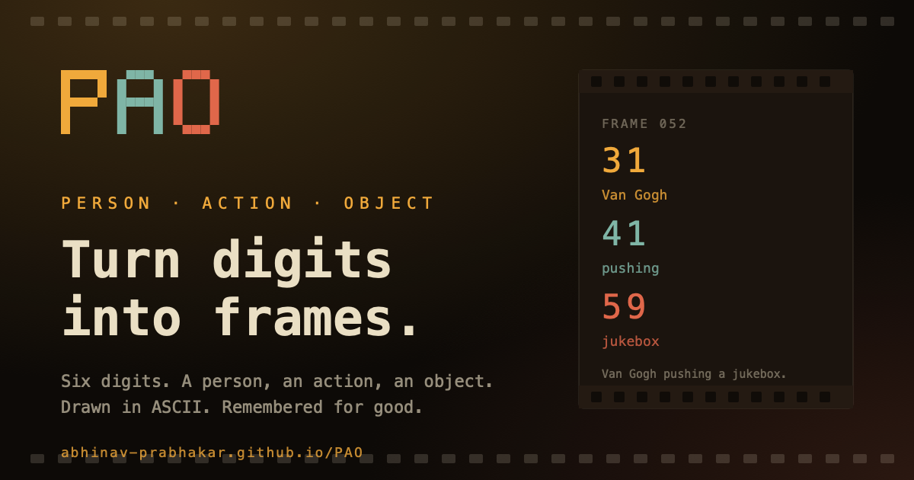
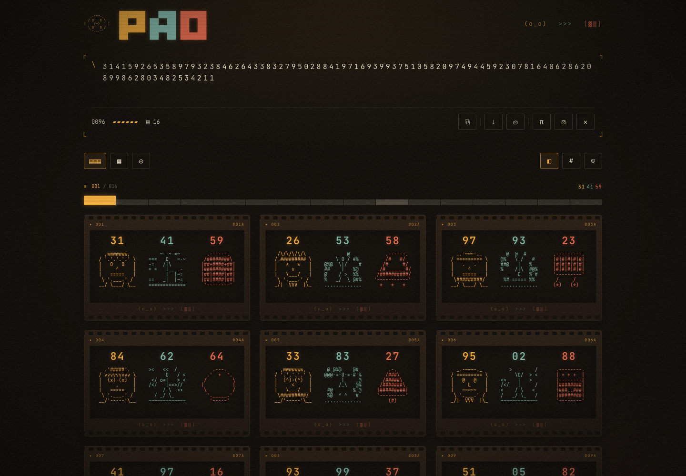
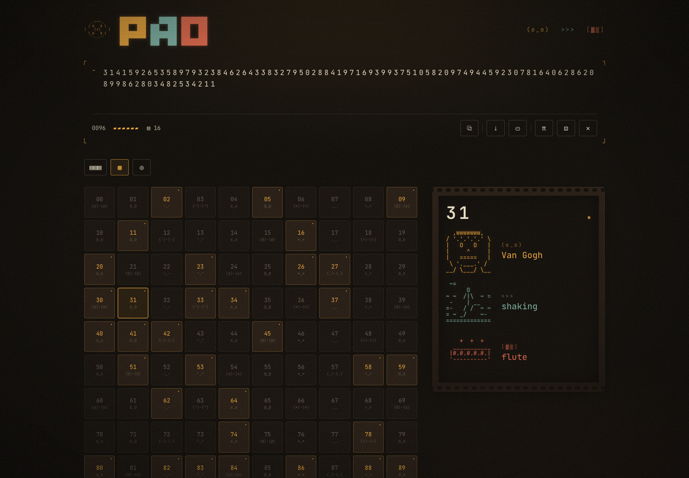
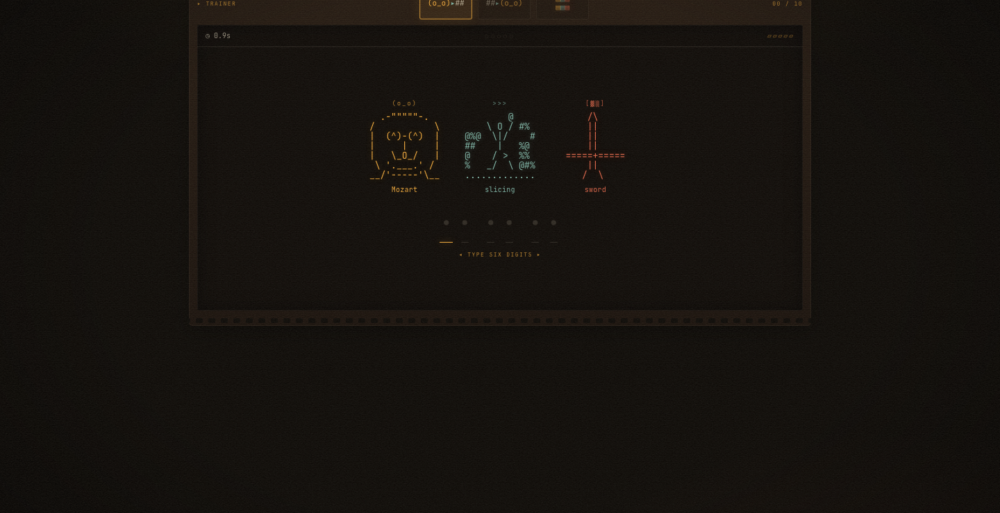
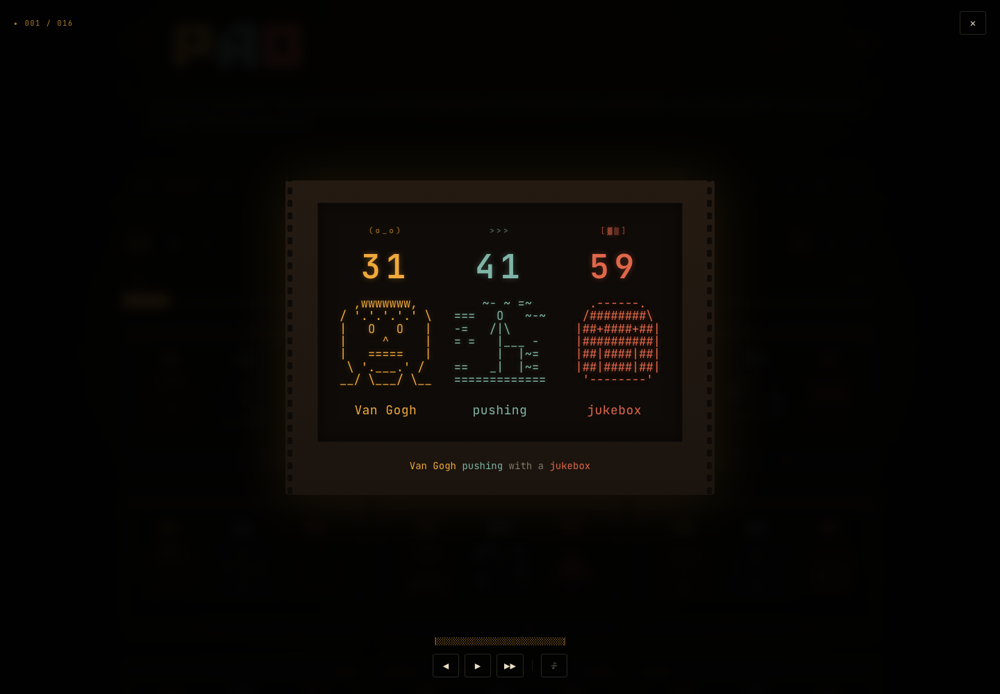
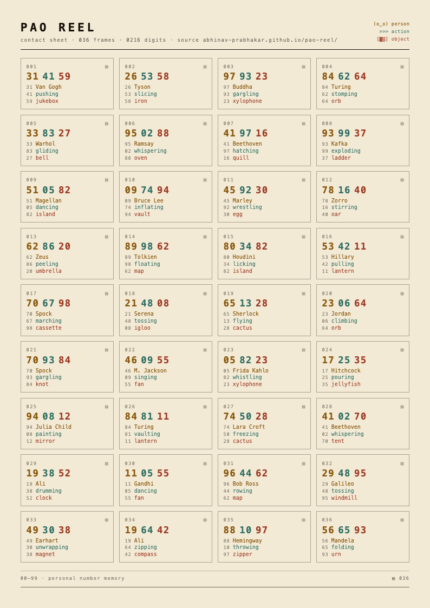

<div align="center">



# PAO

**Turn digits into frames.**

Six digits become a **Person**, an **Action**, and an **Object**, drawn in ASCII.<br/>
A projector for pi, phone numbers, birthdays, and anything else worth keeping.

[](https://abhinav-prabhakar.github.io/PAO/)
[](https://abhinav-prabhakar.github.io/PAO/)
[](https://react.dev)
[](https://www.typescriptlang.org)
[](https://vite.dev)
[](#the-codex)
[](#under-the-hood)

</div>

---

|  |  |
| :--: | :--: |
| **The reel** — paste digits, get a filmstrip | **The codex** — all 100 objects, illustrated |

|  |  |
| :--: | :--: |
| **The trainer** — decode, encode, or replay a reel | **The projector** — full-screen, keyboard-driven |

<div align="center">
  <sub>ASCII art is live text. Nothing above is an image asset inside the app.</sub>
</div>

---

## What it does

| | | |
| :-- | :-- | :-- |
| **▤ Filmstrip**<br/>Scrub a 200-frame reel. Click or drag to jump. | **⧉ Permalink**<br/>Digits live in the URL hash: `#314159…` recreates the reel. | **⎙ Zine**<br/>Print a cream A4 contact sheet, one cell per frame. |
| **⤓ Export**<br/>Download the whole reel as `.txt`, ASCII art included. | **♪ Sound**<br/>A synthesized projector shutter. Muted until you ask. | **⌨ Keys**<br/>`j` `k` through frames, `Enter` to project, `Esc` out. |
| **◍ Trainer**<br/>Decode words to digits, encode digits to a scene, or study a reel. | **◧ Views**<br/>Numbers, images, or both. Hover reveals what is hidden. | **☁ Offline**<br/>Installable PWA. No install prompt, no analytics, no server. |

---

## The codex

100 objects, each a hand-authored **13 × 7** ASCII sprite. A sample:

```text
   .---.        .------.        _          .--------.      .-------.
  /#####\      /########\      / \        /##########\    /  \ | /  \
 /#######\    |##########|    /   \      |##########|    | -- * -- |
/#########\   |##########|   |  +  |      \########/      \  / | \  /
'-'-'-'-'-'   |##########|    \   /        '------'        '-------'
     |         \########/      |  |       /    \             |#|
     \__          '------'      '--'                      .-'#'-.
  umbrella        eraser      balloon       drum           gramophone
```

Every number 00–99 gets its own person, action, and object. The codex is the
index; hover any tile to see the triple at full size.

---

## Print it

<div align="center">
  <a href="docs/contact-sheet.png"></a>
  <br/>
  <sub><b>⎙ print contact sheet</b> → A4 zine page · digits, PAO pairs, role colors, page mark</sub>
</div>

The sheet is generated from the reel itself, not a screenshot. Print 6, 36, or
200 frames; the page breaks where the paper does.

---

## Keyboard

| Key | Action |
| :-- | :-- |
| `j` / `k` | next / previous frame (reel) |
| `←` / `→` | next / previous frame (projector) |
| `Home` / `End` | first / last frame on the filmstrip |
| `Space` | play / pause the projector |
| `Enter` | open the projector from the focused frame |
| `Esc` | close the projector |

---

## Run it

```bash
npm install
npm run dev        # http://localhost:5173
npm run build      # single-file dist/index.html
npm run preview
```

No API keys. No database. `localStorage` remembers the reel, trainer history,
and sound preference. Share the URL hash to share the reel.

---

## Under the hood

| Path | What lives there |
| :-- | :-- |
| `src/lib/words.ts` | 100 persons, 100 actions, 100 objects |
| `src/lib/sprites.ts` | 100 hand-drawn 13×7 object sprites |
| `src/lib/ascii.ts` | deterministic person/action art, chunking, PAO logic |
| `src/lib/artifact.ts` | `.txt` export, permalinks, printable contact sheet |
| `src/lib/sound.ts` | Web Audio projector shutter |
| `src/components/Filmstrip.tsx` | scrubbable reel navigator |
| `src/components/Projector.tsx` | full-screen study and playback |
| `design.md` | the visual contract: film language, color, motion, ASCII rules |

**Stack:** React 19 · TypeScript · Vite 7 · Tailwind 4 · `vite-plugin-singlefile` · zero runtime deps beyond React.<br/>
**Type:** [JetBrains Mono](https://github.com/JetBrains/JetBrainsMono) variable font, self-hosted under the SIL Open Font License.

**Deploy:** `main` is the source and the only branch. GitHub Actions builds
`dist` and publishes it to GitHub Pages at [`/PAO/`](https://abhinav-prabhakar.github.io/PAO/).

---

<div align="center">

```text
   .-"""-.
  /  PAO  \
 | 31 41 59 |
  \       /
   '-...-'
```

<sub>Person · Action · Object — a reel you can hold in your head.</sub>

</div>
